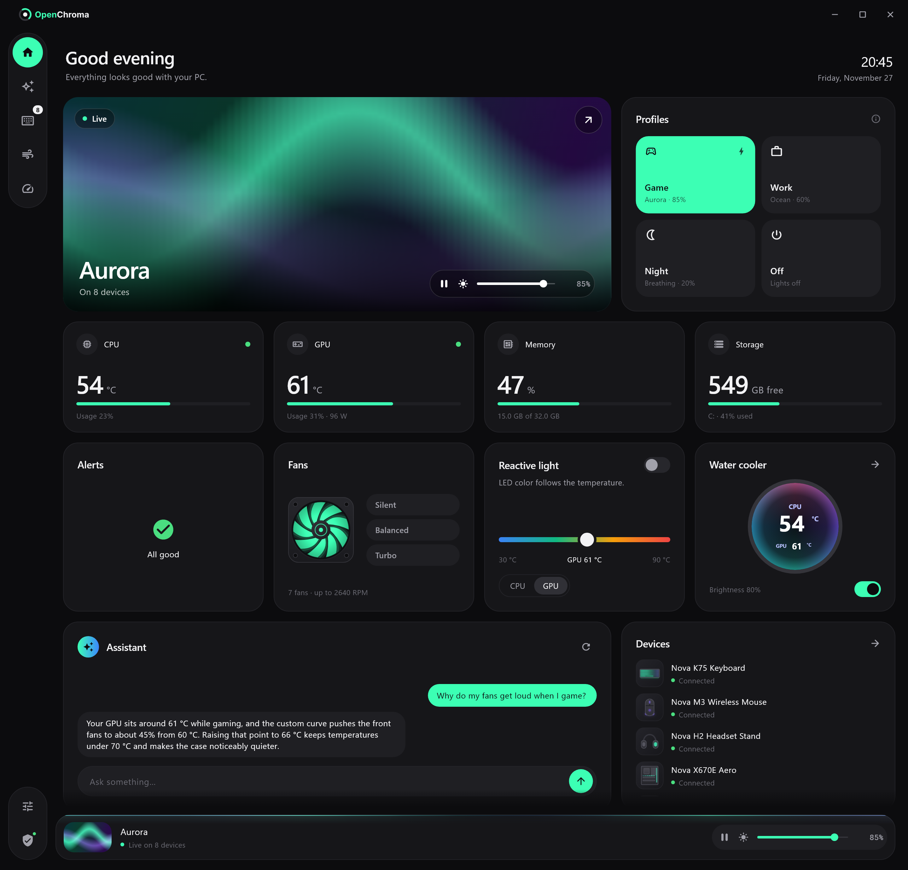

# OpenChroma

**English** | [Português (Brasil)](README.pt-BR.md)

[](https://github.com/Dnowdd/OpenChroma/actions/workflows/ci.yml)
[](LICENSE)
[](https://github.com/Dnowdd/OpenChroma/releases)
[](#installation)

Control your whole PC from one place: the RGB lighting of every device, the
fans, the temperatures and the health of the system. Free, open source and
made for Windows.

> **Status: beta.** OpenChroma 0.9 is the first public release. Expect rough
> edges, and please [report bugs](https://github.com/Dnowdd/OpenChroma/issues/new/choose).
> Read the [disclaimer](#disclaimer--use-at-your-own-risk) before using it.



## What it does

**Lighting**
- 25 original effects: Aurora, Plasma, Lava, Campfire, Digital Rain, Starry
  Sky, Rainbow, Solid Color, Heartbeat, Siren and more. Each one has color
  and speed settings.
- Effects that react to the PC's sound or the microphone (Spectrum, Neon
  Equalizer, Beat, Sound Wave…).
- Layout: place each device on a canvas and the effect "flows" across them
  as if they were a single panel.
- Profiles (Gaming, Work, Night, Off) that switch effect and brightness in
  one click. Right-click a profile to save the current lighting into it.
- Reactive light: the LEDs show the CPU or GPU temperature, from blue
  (cool) to red (hot).
- Import `.ocfx` effects (see below) or HTML pages with a canvas.

**Fans**
- Reads and controls motherboard fans (ITE chips) and NVIDIA graphics card
  fans, with Silent, Balanced and Turbo profiles or your own curve.
- Mark which fan is the liquid cooler pump, so it never stops.

**Performance**
- Real-time monitor: CPU and GPU usage and temperature, memory, disks,
  network and the heaviest processes.
- Diagnostics: CPU, memory, GPU and disk stress tests that check the results
  (they don't just heat up the PC), hardware inventory, blue screen history
  and recommendations.

**Alerts**
- Windows notification when something gets too hot, memory or a disk fills
  up, or the liquid cooler pump stops. Works with the app in the tray.
- Optional: the LEDs flash red along with the alert.

**AI assistant**
- Ask about your PC ("why is it slow?", "what heats up the GPU?"): the
  assistant answers with the machine's real readings.
- Ask for an effect ("make a calm blue effect") and apply it in one click.
- Explains the diagnostics results and suggests what to do.
- Works with your own key from Anthropic (Claude), OpenAI (GPT) or any
  service compatible with the OpenAI API (OpenRouter, Groq, Ollama,
  LM Studio…). The model list is fetched from the provider and updates by
  itself.

**Everyday use**
- Closes to the tray and keeps taking care of lights and fans.
- Can start with Windows, including as administrator without a UAC prompt
  every time (only when installed for all users, in Program Files, so other
  programs can't swap the files that run elevated).
- English by default, with a Portuguese (Brazil) translation: switch it in
  **Settings › General › Language**.

| Effects | Devices |
|---|---|
|  |  |

## Disclaimer / use at your own risk

OpenChroma talks to hardware at a low level. In particular, it:

- writes to the **SMBus** to control the RGB of RAM modules and graphics
  cards;
- **controls fan speeds**, including the liquid cooler pump if you set one;
- installs the **[PawnIO](https://pawnio.eu) kernel driver** (needed for
  SMBus, CPU temperature and motherboard fans);
- can **run as administrator**, including at startup.

Wrong writes to hardware can, in rare cases, make a device misbehave,
lose its settings or even become permanently damaged ("bricked"). OpenRGB,
which most of OpenChroma's drivers come from, carries a similar warning.
The software is provided **"as is", without warranty of any kind**, as
stated in the [GPL](LICENSE). By using it you accept these risks.

OpenChroma is an independent project. It is **not affiliated with, endorsed
by or sponsored by** Razer, Corsair, ASUS, Logitech, Gigabyte, MSI, Kingston,
Sony or any other brand mentioned here. All trademarks belong to their
respective owners and are used only to identify compatible hardware.

## Installation

Download the latest version from
[Releases](https://github.com/Dnowdd/OpenChroma/releases):

- **`OpenChroma-x.y.z-setup.exe`**: the installer. By default it installs
  for your user only, without administrator rights; pick "all users" to
  install in Program Files, which is needed to start as administrator at
  logon. It installs Microsoft WebView2 if it's missing.
- **`OpenChroma-x.y.z-portable.zip`**: extract it to a folder and open
  `openchroma.exe`. Nothing gets installed.
- **`SHA256SUMS.txt`**: checksums to verify the download.

Requirements:

- Windows 10 (1809 or newer) or Windows 11, 64-bit.
- [Microsoft WebView2](https://developer.microsoft.com/microsoft-edge/webview2/),
  only for imported HTML effects. It ships with Windows 11; the installer
  takes care of it on Windows 10.
- The [PawnIO](https://pawnio.eu) driver for RAM and graphics card RGB, CPU
  temperature and motherboard fans. The installer bundles the official setup
  and installs it in the background. These features also need administrator
  mode (there's a button for it in the app).

The executable isn't code-signed yet, so Windows SmartScreen may say
"Windows protected your PC" the first time. Click **More info › Run anyway**.

Close other RGB programs (iCUE, G HUB, RGB Fusion, OpenRGB…) before using
it: two programs writing to the same LEDs make the colors flicker.
OpenChroma warns you when it finds one of them running.

## Supported devices

OpenChroma's drivers come from the open source code of
[OpenRGB](https://gitlab.com/CalcProgrammer1/OpenRGB), compiled into the app
itself: over a thousand keyboards, mice, headsets, mousepads, motherboards,
ARGB controllers, liquid coolers, RAM modules and graphics cards from dozens
of brands (ASUS, Corsair, Logitech, Razer, SteelSeries, HyperX, Gigabyte,
MSI, NZXT, Lian Li, Cooler Master…). You don't need to install OpenRGB or any
other program.

**Tested by the author** on real hardware:

| Device | How |
|---|---|
| Attack Shark K86 keyboard (per-key lighting, screen, clock) | Plugin |
| Attack Shark X11 mouse (lighting, hardware effects, battery; wired and 2.4 GHz) | Plugin |
| Logitech G403 HERO mouse | Plugin |
| Sony DualShock 4 controller (with battery) | Plugin |
| SmartMonitorX28 AIO cooler with round screen (CH9340 USB serial) | Plugin |
| Kingston Fury DDR5 RAM | Built-in driver (SMBus) |
| Gigabyte B650M AORUS ELITE AX ICE motherboard RGB | Built-in driver |

**Everything else is untested by this project.** Those devices use drivers
inherited from OpenRGB that compile and pass the automated tests, but nobody
has tried them with OpenChroma yet. They will probably work as well as they
do in OpenRGB, but no promises. If you try one, please tell us how it went
in an [issue](https://github.com/Dnowdd/OpenChroma/issues/new/choose), and use
the device request form for hardware that isn't detected.

- RAM and graphics cards with RGB use the SMBus, which needs administrator
  mode and the [PawnIO](https://pawnio.eu) driver.
- Motherboard ARGB headers: enter how many LEDs are connected to each one on
  the Devices screen.
- Each device can follow OpenChroma's effects or run one of the hardware's
  own effects.
- You can write JavaScript plugins for new devices or to improve existing
  ones: see [docs/PLUGINS.md](docs/PLUGINS.md). The bundled plugins live in
  [`assets/plugins`](assets/plugins).

## `.ocfx` effects

An effect is a JSON file with layers drawn from bottom to top:

```json
{
  "openchroma": 1,
  "name": "Calm Ocean",
  "description": "Blues slowly coming and going.",
  "background": "#000814",
  "params": {
    "speed": { "label": "Speed", "type": "number", "min": 0, "max": 100, "default": 25 },
    "color": { "label": "Color", "type": "color", "default": "#38BDF8" }
  },
  "layers": [
    { "type": "gradient", "colors": ["#001D3D", "#003566", "#000814"], "angle": 20, "speed": "$speed" },
    { "type": "wave", "color": "$color", "amplitude": 0.2, "thickness": 0.25, "speed": "$speed", "blend": "screen" }
  ]
}
```

Layers: `solid`, `gradient`, `spectrum`, `pulse`, `wave`, `sweep`, `rings`,
`sparkle`, `plasma`, `noise`, `fire`, `rain`, `stars`, `heartbeat`, `strobe`
and, for audio, `bars`, `meter`, `ripple` and `flash`. A `"$name"` value uses
the `name` parameter; `"@bass"`, `"@mid"`, `"@treble"`, `"@level"` and
`"@beat"` use the live sound. The effects that ship with the app are in
[`assets/effects`](assets/effects) and work as examples.

## Privacy

- There is no telemetry. The only automatic connection is a daily update
  check against the GitHub releases API (turn it off in Settings › About);
  it sends nothing about your PC.
- The assistant's API key stays on this PC only, encrypted for your Windows
  user (DPAPI), and only goes to the provider you chose, together with the
  PC readings used to answer (hardware model, temperatures, usage, device
  names and the names of the heaviest processes).
- Plain HTTP is only accepted for AI servers running on this PC.
- Settings are stored in `%APPDATA%\OpenChroma`.

## For developers

You need [Flutter](https://docs.flutter.dev/get-started/install/windows)
3.47 or newer and Visual Studio 2022 (or newer) with the "Desktop
development with C++" workload.

```powershell
flutter pub get
flutter run -d windows        # run in debug mode
flutter test                  # tests
```

- [CONTRIBUTING.md](CONTRIBUTING.md): setup, tests, code style, translations
  and how to send a pull request.
- [docs/BUILDING.md](docs/BUILDING.md): building the `.exe` and the installer
  and publishing a release.
- [docs/PLUGINS.md](docs/PLUGINS.md): writing device plugins.
- [ROADMAP.md](ROADMAP.md): what's still missing.
- [CHANGELOG.md](CHANGELOG.md): what changed in each version.
- [SECURITY.md](SECURITY.md): how to report a vulnerability.

### How it works

```
lib/src/
  engine/        engine: layout, samples the effect at each LED and sends it
                 to the drivers; profiles, reactive light and alert flashing
  drivers/       bridge to the native drivers (oc_drivers.dll)
  plugins/       JavaScript plugins: API, loading and each device's worker
                 (QuickJS)
  hid/           direct USB HID access through Windows, for the plugins
  effects/       effect library, the .ocfx renderer in Dart and the WebView2
                 host for imported HTML effects
  fans/          fan curves and control
  monitor/       system readings (native side in windows/runner)
  checkup/       diagnostics and blue screen analysis
  alerts/        alerts and notifications
  ai/            assistant: providers, keys (DPAPI) and PC context
  ui/            the screens
lib/l10n/        translations (English and Portuguese)
windows/runner/  native code: monitor, fans (PawnIO/NvAPI), stress tests,
                 audio capture, tray and elevation
windows/drivers/ oc_drivers.dll: the OpenRGB drivers with OpenChroma's C API
                 (oc_drivers.cpp)
third_party/openrgb/  copy of the OpenRGB code used by the drivers
```

Every ~33 ms the effect draws a frame on a 320x200 canvas: `.ocfx` effects
directly in Dart, imported HTML effects in a WebView2 page that only opens
while one of them is active. The app computes each LED's color from the
device's position in the layout and hands it to the driver, which writes to
the hardware on its own thread.

## License

OpenChroma is free software under the GPL-2.0-or-later ([LICENSE](LICENSE)).
The drivers come from OpenRGB; the bundled third-party code and its licenses
are listed in [THIRD_PARTY.md](THIRD_PARTY.md).

The PawnIO modules in `assets/pawnio` are distributed under the LGPL 2.1
(see `assets/pawnio/COPYING.txt`).
