<div align="center">

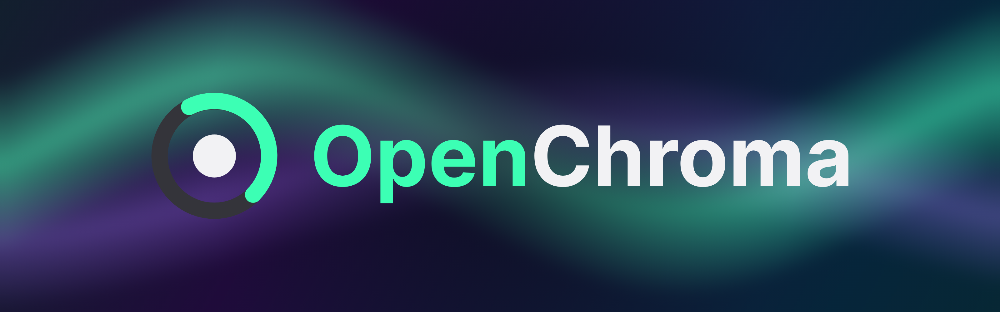

**A free, open-source, non-profit project for RGB lighting, fan control and PC monitoring on Windows.**

[](https://github.com/Dnowdd/OpenChroma/actions/workflows/ci.yml)
[](https://github.com/Dnowdd/OpenChroma/releases)
[](LICENSE)
[](#-install)
[](https://flutter.dev)

**English** · [Português (Brasil)](README.pt-BR.md)

[**Download**](https://github.com/Dnowdd/OpenChroma/releases) ·
[Features](#-features) ·
[Supported devices](#-supported-devices) ·
[Write a plugin](docs/PLUGINS.md) ·
[Roadmap](ROADMAP.md)

</div>

> [!NOTE]
> **Beta.** 0.9 is the first public release. Expect rough edges and please
> [report what you find](https://github.com/Dnowdd/OpenChroma/issues/new/choose).
> OpenChroma talks to hardware at a low level, so read the
> [disclaimer](#%EF%B8%8F-disclaimer) first.

<a href="docs/video/showcase.mp4">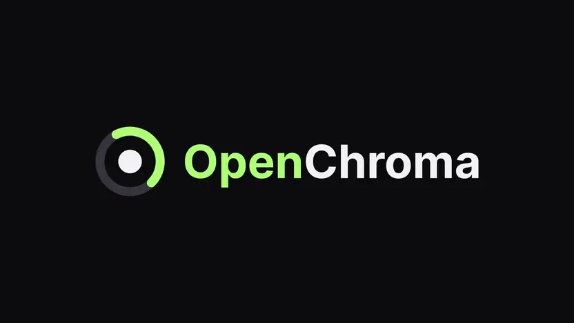</a>

## Why OpenChroma

Your keyboard wants one app, the mouse another, the RAM a third, the
motherboard a fourth, and none of them talk to each other. OpenChroma
replaces all of them with a single, fast app that:

- 🌈 **Syncs every device** into one canvas, so an effect flows across the
  keyboard, fans, RAM and GPU as if they were one panel.
- 🌀 **Drives your fans** from temperature curves, motherboard and NVIDIA
  GPU alike, and never lets the pump stop.
- 📈 **Watches your PC**: live temperatures, usage, processes, stress tests
  and blue screen history.
- 🤖 **Explains it in plain words** with an optional AI assistant that reads
  your real sensor data.
- 🔓 **Stays open**: GPL, no account, no telemetry, no cloud. Drivers from
  [OpenRGB](https://gitlab.com/CalcProgrammer1/OpenRGB) compiled right in,
  and JavaScript plugins for anything else.

<div align="center">
  
  <br><sub>The dashboard: profiles, the running effect, fans, temperatures and the assistant at a glance.</sub>
</div>

## ✨ Features

<table>
<tr>
<td width="50%" valign="top">

### 🎨 Lighting that flows

- **25+ original effects** (Aurora, Plasma, Lava, Campfire, Digital Rain,
  Starry Sky, Neon Rings…), each with its own colors and speed.
- **Sound reactive** effects driven by what's playing or by the mic.
- **Profiles** (Gaming, Work, Night, Off) that switch by themselves when a
  game or program opens.
- **Reactive light**: the LEDs turn from blue to red with the CPU or GPU
  temperature.
- Import `.ocfx` effects or HTML canvas pages, or let the assistant
  write one for you.

</td>
<td width="50%" valign="top">

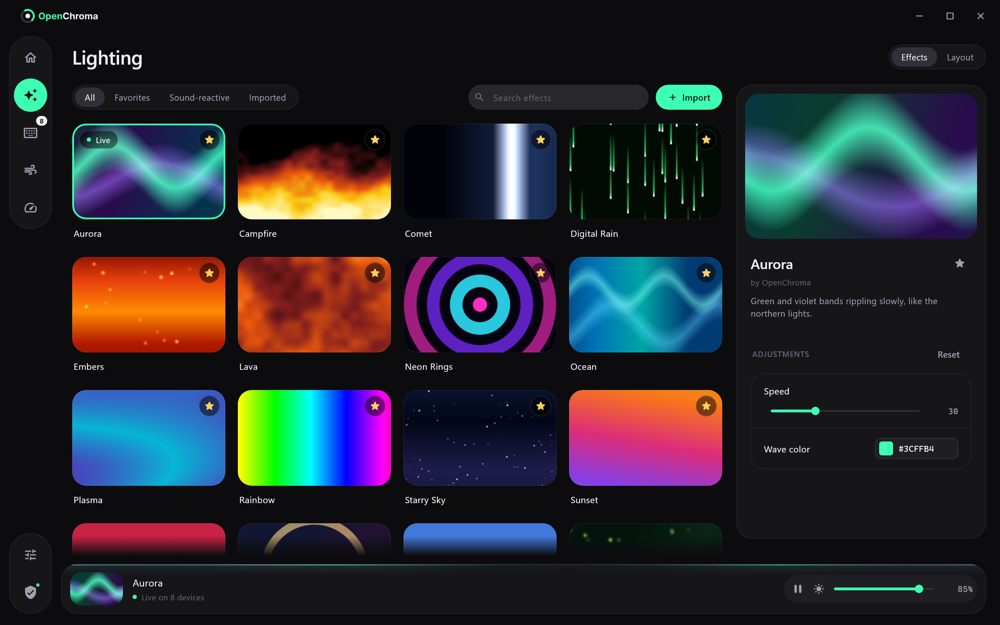

</td>
</tr>
<tr>
<td width="50%" valign="top">

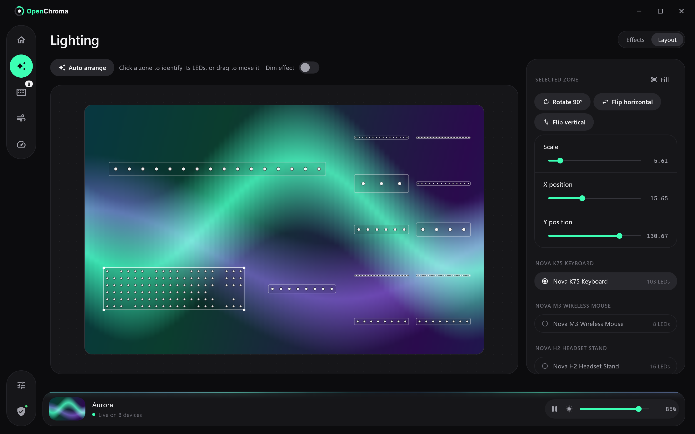

</td>
<td width="50%" valign="top">

### 🧩 One canvas for every device

- Drag, resize, **rotate and flip** each device and zone where it really is
  on your desk.
- **Auto arrange** in one click, with a preview and undo.
- Click a zone and its LEDs blink, so you always know which is which.
- Per-device brightness, color order calibration and LED counts for ARGB
  headers.

</td>
</tr>
<tr>
<td width="50%" valign="top">

### ⌨️ Devices, your way

- Each device follows the app's effects **or runs its own hardware
  effect**, with speed, brightness, direction and colors.
- Battery levels for wireless gear.
- **Screens on devices**: send images and GIFs to keyboard and cooler
  displays, crop and zoom them, and add live CPU and GPU readings.

</td>
<td width="50%" valign="top">

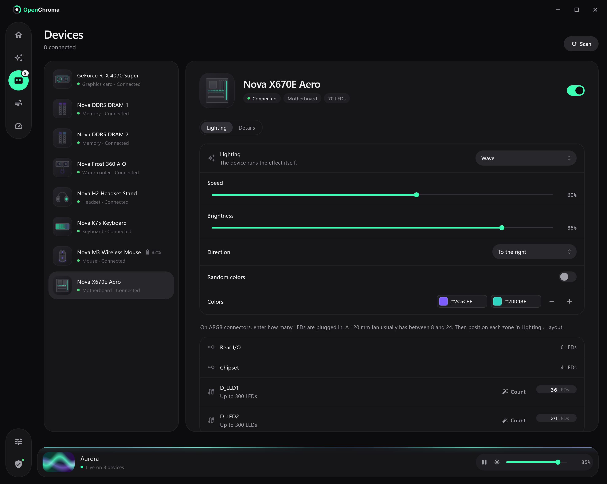

</td>
</tr>
<tr>
<td width="50%" valign="top">

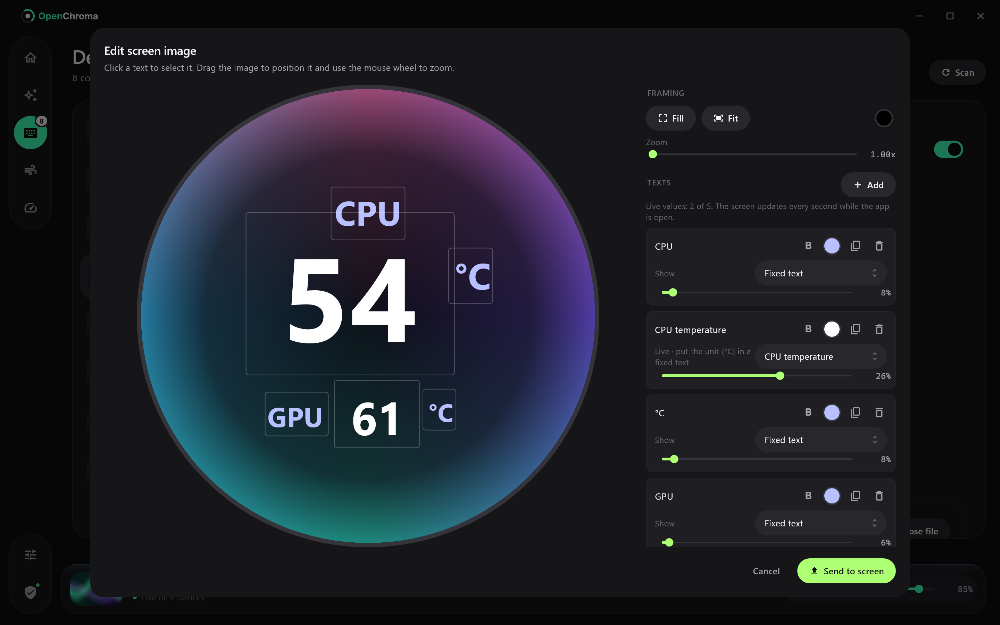

</td>
<td width="50%" valign="top">

### 🖼️ A real editor for device screens

- Lay out text and **live values** (temperatures, usage, clocks, power) on
  a round 480×480 AIO screen with snapping guides and shortcuts.
- Images and GIFs with frame range, crop and zoom.
- Built-in size limits keep the cooler safe.

</td>
</tr>
<tr>
<td width="50%" valign="top">

### 🌀 Quiet when you work, cool when you play

- Motherboard (ITE) and NVIDIA GPU fans.
- **Silent, Balanced and Turbo** profiles or your own curve.
- Mark the pump so it never stops, even if a curve says so.

</td>
<td width="50%" valign="top">

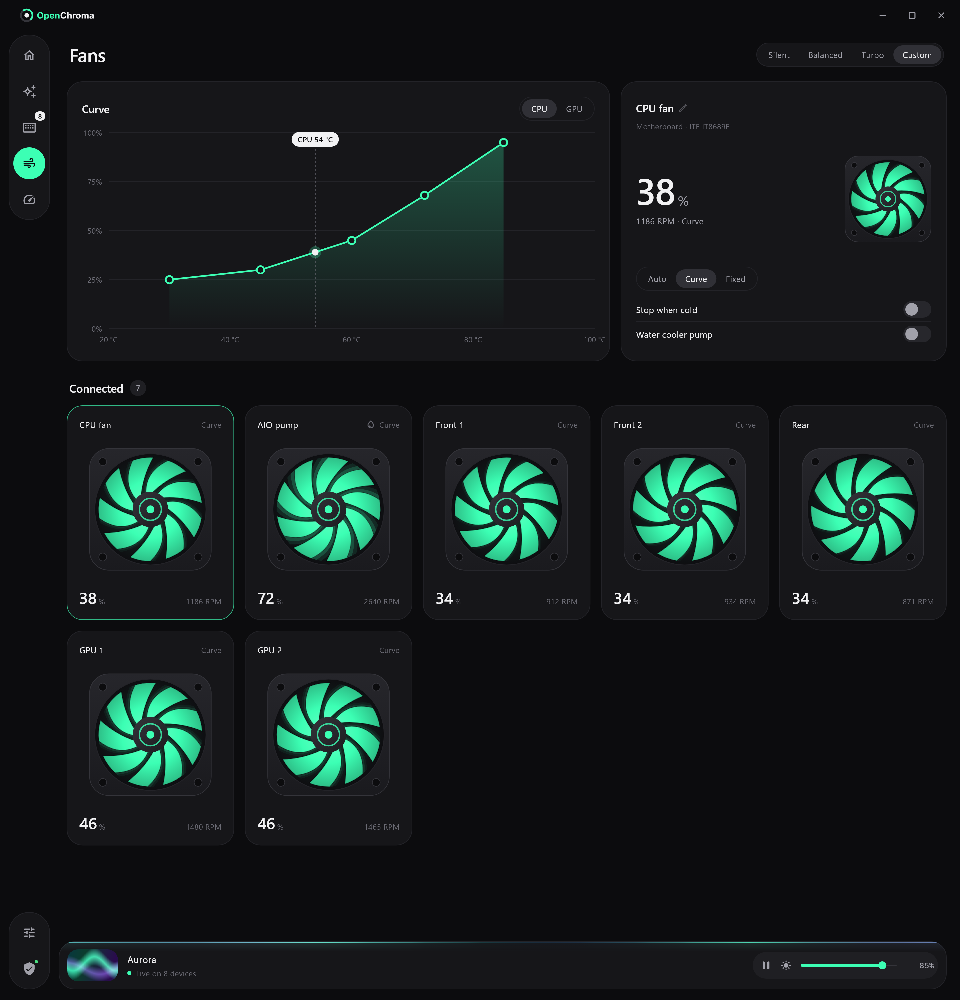

</td>
</tr>
<tr>
<td width="50%" valign="top">

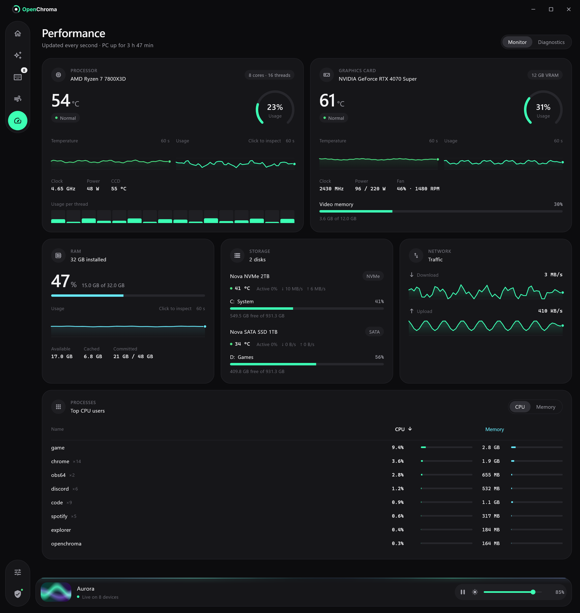

</td>
<td width="50%" valign="top">

### 📈 Know what your PC is doing

- CPU, GPU, memory, disks and network, live, with a one-minute history.
- **Click any point on a chart** to see which processes were running then.
- Sort processes by CPU or memory and spot the heavy ones.

</td>
</tr>
<tr>
<td width="50%" valign="top">

### 🩺 Diagnostics that check the results

- CPU, memory, GPU and disk **stress tests that verify the math**, not
  just heat things up.
- Hardware inventory, blue screen history with the drivers involved, and
  clear recommendations.
- Ask the assistant to explain the report.

</td>
<td width="50%" valign="top">

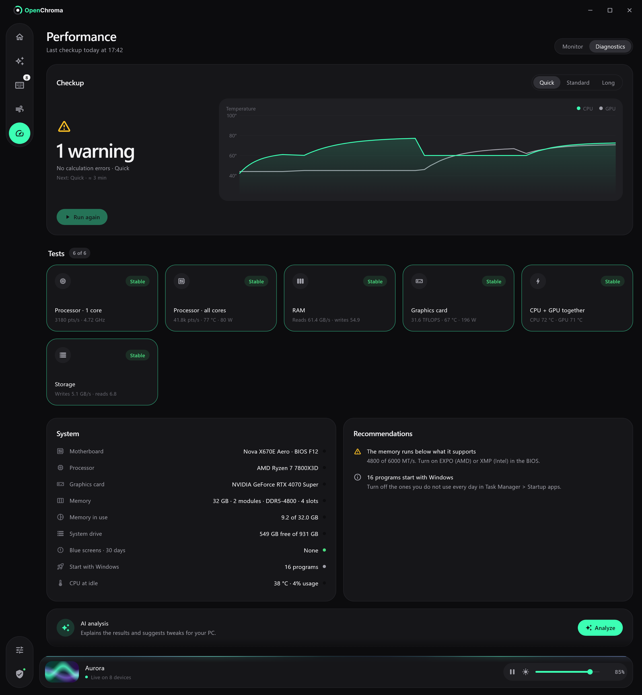

</td>
</tr>
</table>

**A free, open-source, non-profit project for RGB lighting, fan control and PC monitoring on Windows.**

- 🔔 **Alerts**: a Windows notification (and, if you want, a red flash on
  the LEDs) when something runs hot, memory or a disk fills up, or the pump
  stops.
- 🤖 **AI assistant**: ask "why is my PC slow?" or "make a calm blue
  effect". Bring your own key for Anthropic (Claude), OpenAI or any
  OpenAI-compatible API, including local ones like Ollama and LM Studio.
- 🪟 **Lives in the tray**, starts with Windows, keeps memory use low with
  the window closed, and checks for updates (you can turn that off).
- 🌍 **English and Português (Brasil)**: switch in Settings › General ›
  Language.

<div align="center">
  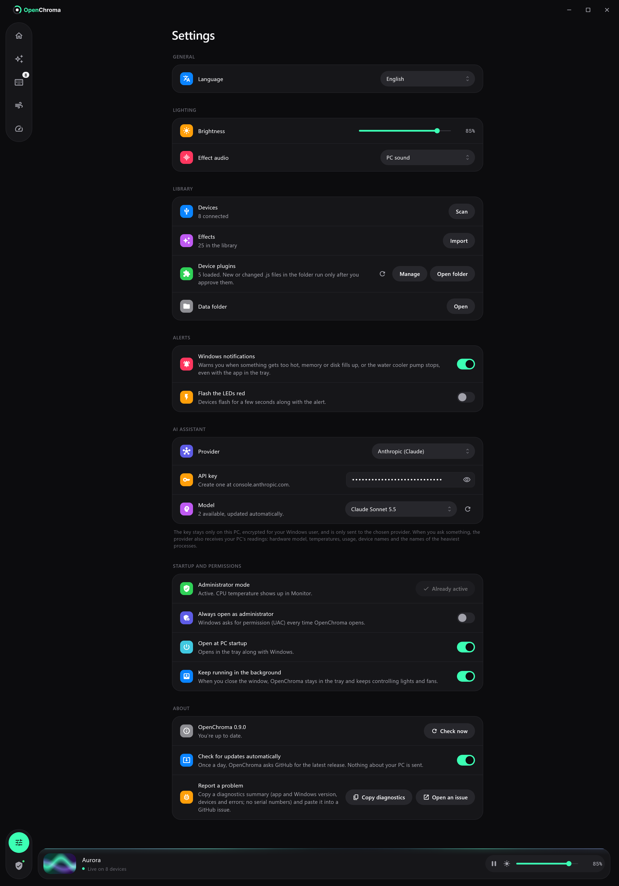
</div>

## 📦 Install

1. Download the latest **`OpenChroma-x.y.z-setup.exe`** from
   [Releases](https://github.com/Dnowdd/OpenChroma/releases)
   (or the **portable `.zip`** if you'd rather not install anything).
2. Run it. The installer adds Microsoft WebView2 if it's missing and, if
   you leave the box checked, the [PawnIO](https://pawnio.eu) driver used
   for RAM and GPU lighting, CPU temperature and motherboard fans.
3. **Close other RGB apps** (iCUE, G HUB, RGB Fusion, OpenRGB…): two apps
   writing to the same LEDs make them flicker. OpenChroma warns you when it
   finds one.

<details>
<summary><b>Requirements and good to know</b></summary>

- Windows 10 (1809 or newer) or Windows 11, 64-bit.
- By default the installer installs for your user only, without
  administrator rights. Choose **all users** to install in Program Files,
  which is required to start as administrator at logon.
- SMBus devices (RAM, GPUs), CPU temperature and motherboard fans need
  administrator mode; there's a button for it in the app.
- The app isn't code-signed yet, so SmartScreen may say "Windows protected
  your PC" the first time: click **More info › Run anyway**. Every release
  ships a `SHA256SUMS.txt` so you can verify the download.

</details>

## 🔌 Supported devices

The built-in drivers come from [OpenRGB](https://gitlab.com/CalcProgrammer1/OpenRGB),
compiled into the app: **about 2,160 models from 189 families** of
keyboards, mice, headsets, mousepads, motherboards, ARGB controllers, AIO
coolers, RAM and graphics cards from ASUS, Corsair, Logitech, Razer,
SteelSeries, HyperX, Gigabyte, MSI, NZXT, Lian Li, Cooler Master and more.
No need to install OpenRGB.

**A free, open-source, non-profit project for RGB lighting, fan control and PC monitoring on Windows.**

| Device                                                                          | Through                 |
| ------------------------------------------------------------------------------- | ----------------------- |
| Attack Shark K86 keyboard: per-key lighting, screen, clock                      | Plugin                  |
| Attack Shark X11 mouse: lighting, hardware effects, battery (wired and 2.4 GHz) | Plugin                  |
| Logitech G403 HERO mouse                                                        | Plugin                  |
| Sony DualShock 4 controller, with battery                                       | Plugin                  |
| SmartMonitorX28 AIO cooler with round screen (CH9340 USB serial)                | Plugin                  |
| Kingston Fury DDR5 RAM                                                          | Built-in driver (SMBus) |
| Gigabyte B650M AORUS ELITE AX ICE motherboard RGB                               | Built-in driver         |

Everything else uses OpenRGB's drivers and **hasn't been tried with
OpenChroma yet**. It should work as well as it does in OpenRGB, but no
promises. Tried one? Tell us in an
[issue](https://github.com/Dnowdd/OpenChroma/issues/new/choose). Device not
detected? Use the **device request** form, or
[write a plugin](docs/PLUGINS.md): a few dozen lines of JavaScript, reloaded
live while you edit.

## 🎛️ Make your own effects

An `.ocfx` effect is a small JSON file with layers drawn bottom to top.
Parameters become controls in the app, and `@bass`, `@mid`, `@treble`,
`@level` and `@beat` follow the music.

```json
{
  "openchroma": 1,
  "name": "Calm Ocean",
  "description": "Blues slowly coming and going.",
  "background": "#000814",
  "params": {
    "speed": {
      "label": "Speed",
      "type": "number",
      "min": 0,
      "max": 100,
      "default": 25
    },
    "color": { "label": "Color", "type": "color", "default": "#38BDF8" }
  },
  "layers": [
    {
      "type": "gradient",
      "colors": ["#001D3D", "#003566", "#000814"],
      "angle": 20,
      "speed": "$speed"
    },
    {
      "type": "wave",
      "color": "$color",
      "amplitude": 0.2,
      "thickness": 0.25,
      "speed": "$speed",
      "blend": "screen"
    }
  ]
}
```

<details>
<summary><b>Layers, parameters and translations</b></summary>

- Layers: `solid`, `gradient`, `spectrum`, `pulse`, `wave`, `sweep`,
  `rings`, `sparkle`, `plasma`, `noise`, `fire`, `rain`, `stars`,
  `heartbeat`, `strobe` and, for audio, `bars`, `meter`, `ripple` and
  `flash`.
- `"$name"` reads the `name` parameter; `"@bass"` and friends read the live
  sound.
- An optional `i18n` block translates the name, description and parameter
  labels:

  ```json
  "i18n": { "pt": { "name": "Oceano Calmo", "params": { "speed": "Velocidade", "color": "Cor" } } }
  ```

- The bundled effects in [`assets/effects`](assets/effects) are good
  starting points.

</details>

## 🏗️ How it works

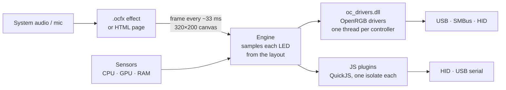

<details>
<summary><b>Project layout</b></summary>

```
lib/src/
  engine/        layout, LED sampling, profiles, reactive light, alert flashing
  drivers/       bridge to the native drivers (oc_drivers.dll)
  plugins/       JavaScript plugins: API, loading, approval and workers
  effects/       effect library, .ocfx renderer and WebView2 host
  fans/          fan curves and control
  monitor/       system readings (native side in windows/runner)
  checkup/       diagnostics and blue screen analysis
  alerts/        alerts and notifications
  ai/            assistant: providers, keys (DPAPI) and PC context
  ui/            the screens
lib/l10n/        translations (English and Portuguese)
windows/runner/  native code: monitor, fans (PawnIO/NvAPI), stress tests,
                 audio capture, tray, elevation and security checks
windows/drivers/ oc_drivers.dll: OpenRGB drivers behind OpenChroma's C API
third_party/openrgb/  the OpenRGB code used by the drivers
```

</details>

## 🔒 Privacy and security

- **No telemetry, no account.** The only automatic connection is a daily
  update check against the GitHub releases API, which you can turn off in
  Settings › About.
- The AI assistant is off until you add a key. The key is encrypted for
  your Windows user (DPAPI) and only goes to the provider you chose, along
  with the PC readings used to answer. Plain HTTP is only allowed for
  servers on your own PC.
- Plugins you add yourself only run after you approve them, and must be
  approved again when they change while the app runs as administrator.
- Settings live in `%APPDATA%\OpenChroma`.
- Found a vulnerability? See [SECURITY.md](SECURITY.md).

## ⚠️ Disclaimer

OpenChroma writes to the **SMBus** (RAM and GPU lighting), **controls fan
speeds** (including the pump), installs the **[PawnIO](https://pawnio.eu)
kernel driver** and can **run as administrator**. Wrong writes to hardware
can, in rare cases, make a device misbehave, lose its settings or become
permanently damaged. OpenRGB carries a similar warning. The software is
provided **"as is", without warranty of any kind**, as stated in the
[GPL](LICENSE). By using it you accept these risks.

OpenChroma is an independent project, **not affiliated with, endorsed by or
sponsored by** Razer, Corsair, ASUS, Logitech, Gigabyte, MSI, Kingston, Sony
or any other brand mentioned here. Trademarks belong to their owners and
are used only to identify compatible hardware.

## 🤝 Contributing

Bug reports, device tests, plugins, translations and code are all welcome.

```powershell
flutter pub get
flutter run -d windows   # Flutter 3.47+ and Visual Studio 2022 with C++ desktop
flutter test
```

- [CONTRIBUTING.md](CONTRIBUTING.md): setup, tests, code style and
  translations.
- [docs/PLUGINS.md](docs/PLUGINS.md): device plugins in JavaScript.
- [docs/BUILDING.md](docs/BUILDING.md): building the installer and
  releases.
- [ROADMAP.md](ROADMAP.md) · [CHANGELOG.md](CHANGELOG.md)

## 📄 License

OpenChroma is free software under the **GPL-2.0-or-later** ([LICENSE](LICENSE)).
The drivers come from OpenRGB; bundled third-party code and licenses are
listed in [THIRD_PARTY.md](THIRD_PARTY.md). The PawnIO modules in
`assets/pawnio` are LGPL-2.1 (see `assets/pawnio/COPYING.txt`).

<div align="center">
<sub>Made for people who just want their PC to look good and run cool.</sub>
</div>
