<div align="center">

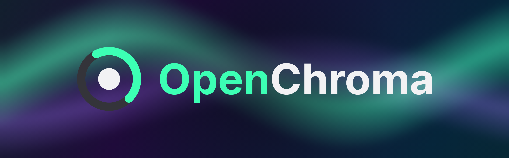

**Um projeto gratuito, de código aberto e sem fins lucrativos para controlar a iluminação RGB e as ventoinhas e monitorar o PC no Windows.**

[](https://github.com/Dnowdd/OpenChroma/actions/workflows/ci.yml)
[](https://github.com/Dnowdd/OpenChroma/releases)
[](LICENSE)
[](#-instalação)
[](https://flutter.dev)

[English](README.md) · **Português (Brasil)**

[**Baixar**](https://github.com/Dnowdd/OpenChroma/releases) ·
[Recursos](#-recursos) ·
[Dispositivos](#-dispositivos-compatíveis) ·
[Escrever um plugin](docs/PLUGINS.md) ·
[Roadmap](ROADMAP.md)

</div>

> [!NOTE]
> **Beta.** A 0.9 é a primeira versão pública. Pode ter arestas; por favor
> [conte o que encontrar](https://github.com/Dnowdd/OpenChroma/issues/new/choose).
> O OpenChroma conversa com o hardware em baixo nível, então leia o
> [aviso](#%EF%B8%8F-aviso) antes.

<a href="docs/video/showcase.mp4">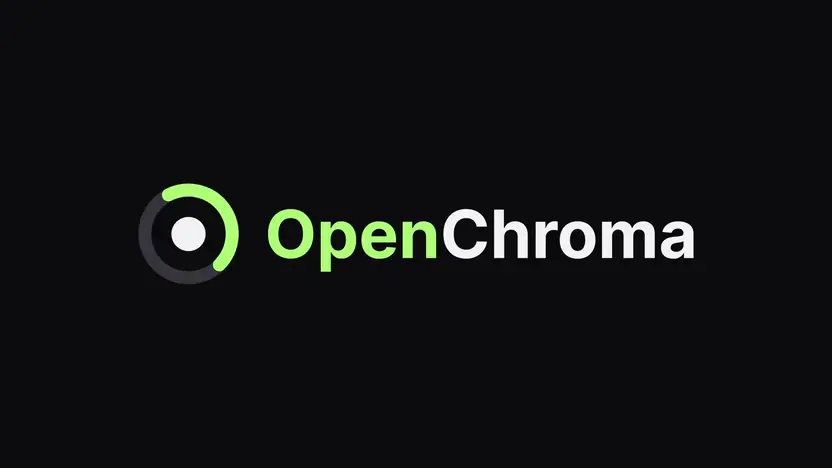</a>

## Por que o OpenChroma

O teclado quer um app, o mouse outro, a memória um terceiro, a placa-mãe um
quarto, e nenhum conversa com o outro. O OpenChroma troca todos eles por um
app só, rápido, que:

- 🌈 **Sincroniza tudo** num canvas só: o efeito passa pelo teclado,
  ventoinhas, memória e placa de vídeo como se fossem um painel.
- 🌀 **Controla as ventoinhas** por curvas de temperatura, da placa-mãe e da
  placa de vídeo NVIDIA, sem nunca deixar a bomba parar.
- 📈 **Acompanha o PC**: temperaturas, uso, processos, testes de estresse e
  histórico de telas azuis, ao vivo.
- 🤖 **Explica em palavras simples** com um assistente de IA opcional que lê
  os sensores de verdade.
- 🔓 **É aberto**: GPL, sem conta, sem telemetria, sem nuvem. Drivers do
  [OpenRGB](https://gitlab.com/CalcProgrammer1/OpenRGB) compilados dentro do
  app, e plugins em JavaScript para o resto.

<div align="center">
  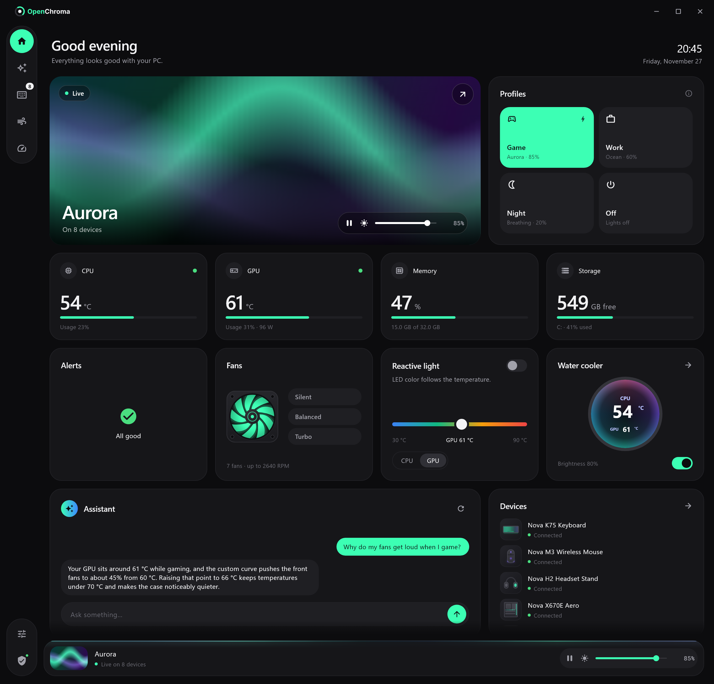
  <br><sub>O painel: perfis, o efeito rodando, ventoinhas, temperaturas e o assistente num relance.</sub>
</div>

## ✨ Recursos

<table>
<tr>
<td width="50%" valign="top">

### 🎨 Iluminação que flui

- **25+ efeitos originais** (Aurora, Plasma, Lava, Fogueira, Chuva Digital,
  Céu Estrelado, Anéis Neon…), cada um com suas cores e velocidade.
- Efeitos que **reagem ao som** do PC ou do microfone.
- **Perfis** (Jogo, Trabalho, Noite, Desligado) que trocam sozinhos quando
  um jogo ou programa abre.
- **Luz reativa**: os LEDs vão do azul ao vermelho com a temperatura da CPU
  ou da GPU.
- Importe efeitos `.ocfx` ou páginas HTML com canvas, ou peça um ao
  assistente.

</td>
<td width="50%" valign="top">

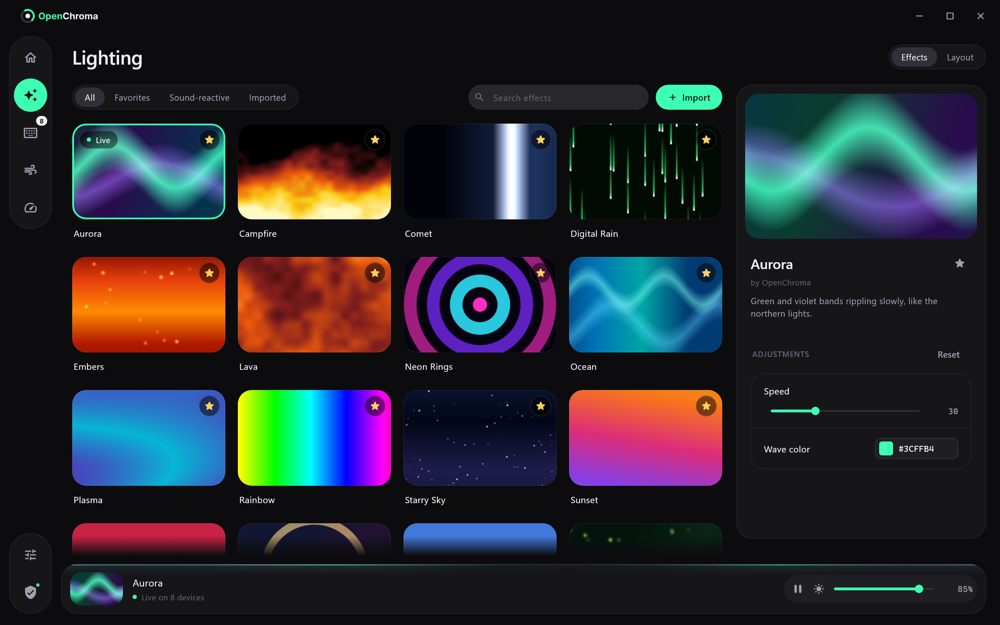

</td>
</tr>
<tr>
<td width="50%" valign="top">

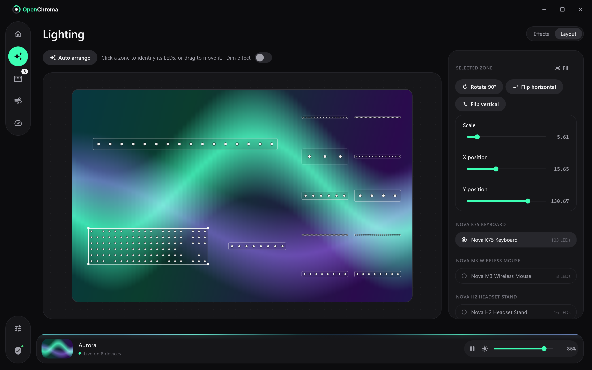

</td>
<td width="50%" valign="top">

### 🧩 Um canvas para todos os dispositivos

- Arraste, redimensione, **gire e espelhe** cada dispositivo e zona do jeito
  que estão na sua mesa.
- **Organizar automaticamente** com um clique, com prévia e desfazer.
- Clique numa zona e os LEDs dela piscam, para saber qual é qual.
- Brilho por dispositivo, calibração da ordem das cores e quantidade de
  LEDs nos conectores ARGB.

</td>
</tr>
<tr>
<td width="50%" valign="top">

### ⌨️ Dispositivos do seu jeito

- Cada dispositivo segue os efeitos do app **ou roda um efeito do próprio
  hardware**, com velocidade, brilho, direção e cores.
- Bateria dos aparelhos sem fio.
- **Telas nos dispositivos**: mande imagens e GIFs para o teclado e a water
  cooler, corte, dê zoom e adicione leituras ao vivo da CPU e da GPU.

</td>
<td width="50%" valign="top">


</td>
</tr>
<tr>
<td width="50%" valign="top">

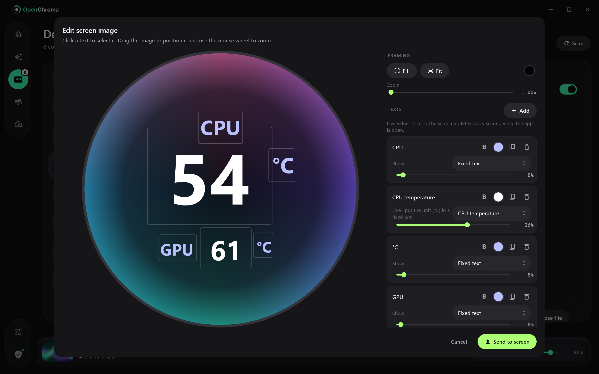

</td>
<td width="50%" valign="top">

### 🖼️ Um editor de verdade para as telas

- Monte textos e **valores ao vivo** (temperaturas, uso, clock, potência)
  numa tela redonda de 480×480, com guias e atalhos.
- Imagens e GIFs com faixa de frames, corte e zoom.
- Limites de tamanho embutidos protegem a water cooler.

</td>
</tr>
<tr>
<td width="50%" valign="top">

### 🌀 Silêncio no trabalho, fôlego no jogo

- Ventoinhas da placa-mãe (ITE) e da placa de vídeo NVIDIA.
- Perfis **Silencioso, Equilibrado e Turbo** ou a sua curva.
- Marque a bomba para ela nunca parar, mesmo que a curva mande.

</td>
<td width="50%" valign="top">

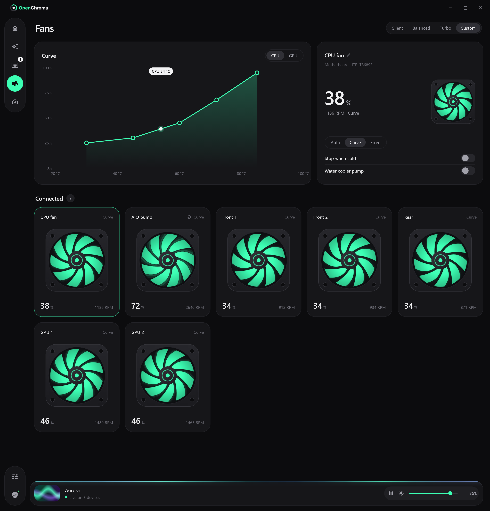

</td>
</tr>
<tr>
<td width="50%" valign="top">

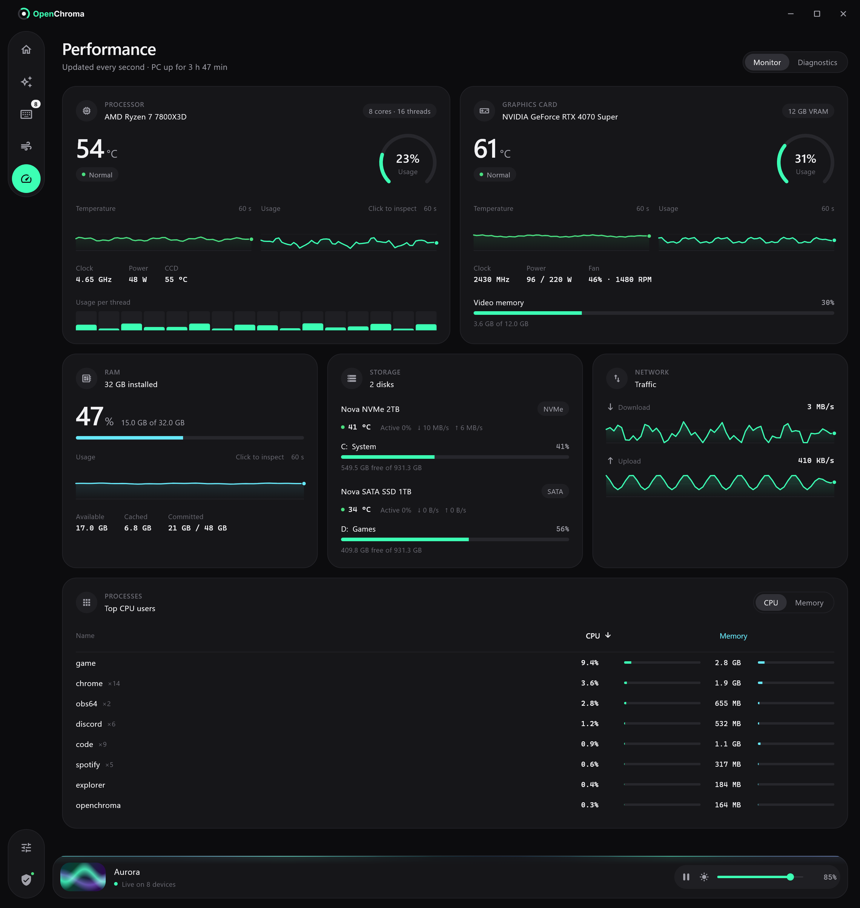

</td>
<td width="50%" valign="top">

### 📈 Saiba o que o PC está fazendo

- CPU, GPU, memória, discos e rede ao vivo, com um minuto de histórico.
- **Clique em qualquer ponto do gráfico** para ver os processos daquele
  momento.
- Ordene os processos por CPU ou memória e ache os pesados.

</td>
</tr>
<tr>
<td width="50%" valign="top">

### 🩺 Diagnóstico que confere o resultado

- Testes de estresse de CPU, memória, GPU e disco **que conferem as
  contas**, não só esquentam o PC.
- Inventário de hardware, histórico de telas azuis com os drivers
  envolvidos e recomendações claras.
- Peça ao assistente para explicar o relatório.

</td>
<td width="50%" valign="top">

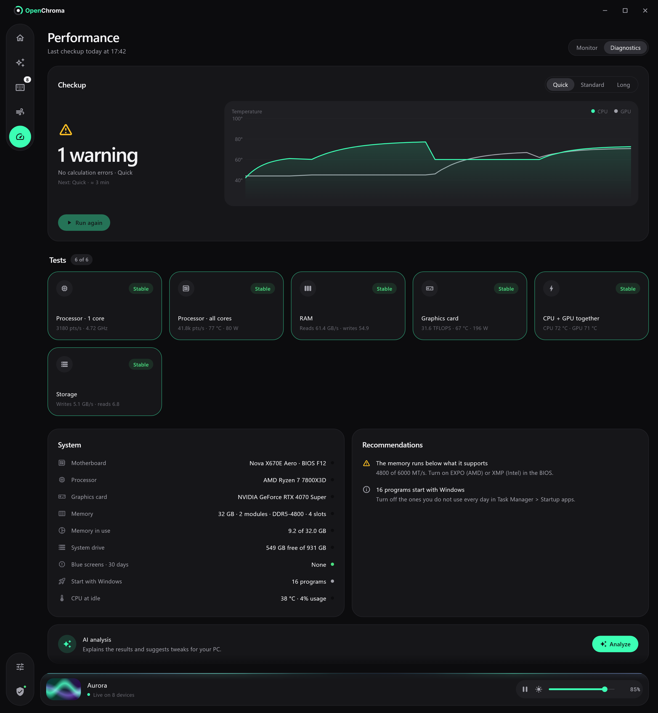

</td>
</tr>
</table>

**Um projeto gratuito, de código aberto e sem fins lucrativos para controlar a iluminação RGB e as ventoinhas e monitorar o PC no Windows.**

- 🔔 **Avisos**: notificação do Windows (e, se quiser, os LEDs piscando em
  vermelho) quando algo esquenta, a memória ou um disco enchem, ou a bomba
  para.
- 🤖 **Assistente de IA**: pergunte "por que meu PC tá lento?" ou peça "um
  efeito azul calmo". Use a sua chave da Anthropic (Claude), da OpenAI ou de
  qualquer API compatível, inclusive locais como Ollama e LM Studio.
- 🪟 **Fica na bandeja**, abre com o Windows, gasta pouca memória com a
  janela fechada e avisa quando sai versão nova (dá para desligar).
- 🌍 **English e Português (Brasil)**: troque em Configurações › Geral ›
  Idioma.

<div align="center">
  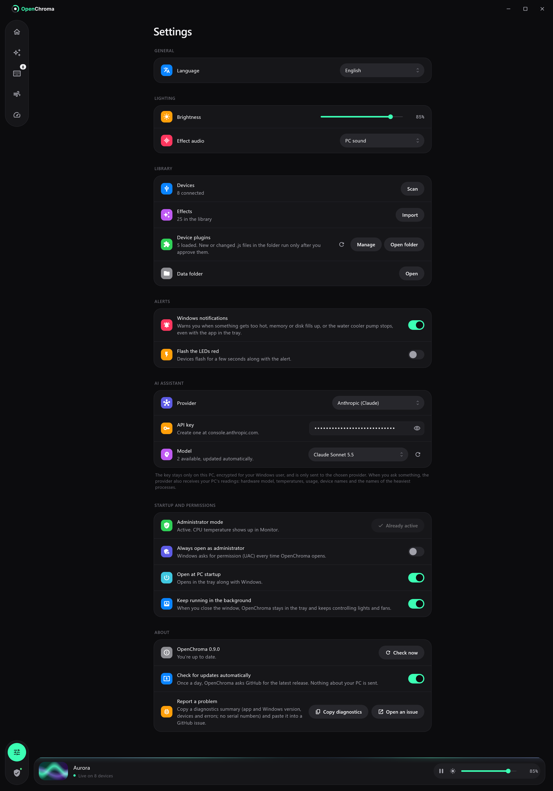
</div>

## 📦 Instalação

1. Baixe o **`OpenChroma-x.y.z-setup.exe`** mais recente em
   [Releases](https://github.com/Dnowdd/OpenChroma/releases)
   (ou o **`.zip` portátil**, se preferir não instalar nada).
2. Rode. O instalador coloca o Microsoft WebView2 se faltar e, se a opção
   ficar marcada, o driver [PawnIO](https://pawnio.eu), usado pelo RGB da
   memória e da placa de vídeo, pela temperatura da CPU e pelas ventoinhas
   da placa-mãe.
3. **Feche outros apps de RGB** (iCUE, G HUB, RGB Fusion, OpenRGB…): dois
   apps escrevendo nos mesmos LEDs fazem as cores piscarem. O OpenChroma
   avisa quando encontra um.

<details>
<summary><b>Requisitos e o que é bom saber</b></summary>

- Windows 10 (1809 ou mais novo) ou Windows 11, 64 bits.
- Por padrão o instalador instala só para o seu usuário, sem pedir
  administrador. Escolha **todos os usuários** para instalar em Arquivos de
  Programas, o que é necessário para abrir como administrador no logon.
- Dispositivos no SMBus (memória, placas de vídeo), a temperatura da CPU e
  as ventoinhas da placa-mãe precisam do modo administrador; tem um botão
  para isso no app.
- O app ainda não tem assinatura de código, então o SmartScreen pode dizer
  "O Windows protegeu o computador" na primeira vez: clique em **Mais
  informações › Executar assim mesmo**. Toda versão traz um
  `SHA256SUMS.txt` para conferir o download.

</details>

## 🔌 Dispositivos compatíveis

Os drivers embutidos vêm do [OpenRGB](https://gitlab.com/CalcProgrammer1/OpenRGB),
compilados dentro do app: **cerca de 2.160 modelos de 189 famílias** de
teclados, mouses, headsets, mousepads, placas-mãe, controladoras ARGB, water
coolers, memórias e placas de vídeo da ASUS, Corsair, Logitech, Razer,
SteelSeries, HyperX, Gigabyte, MSI, NZXT, Lian Li, Cooler Master e outras.
Não precisa instalar o OpenRGB.

**Um projeto gratuito, de código aberto e sem fins lucrativos para controlar a iluminação RGB e as ventoinhas e monitorar o PC no Windows.**

| Dispositivo                                                             | Por                     |
| ----------------------------------------------------------------------- | ----------------------- |
| Teclado Attack Shark K86: luz tecla por tecla, tela, relógio            | Plugin                  |
| Mouse Attack Shark X11: luz, efeitos do mouse, bateria (cabo e 2.4 GHz) | Plugin                  |
| Mouse Logitech G403 HERO                                                | Plugin                  |
| Controle Sony DualShock 4, com bateria                                  | Plugin                  |
| Water cooler SmartMonitorX28 com tela redonda (serial USB CH9340)       | Plugin                  |
| Memória Kingston Fury DDR5                                              | Driver embutido (SMBus) |
| RGB da placa-mãe Gigabyte B650M AORUS ELITE AX ICE                      | Driver embutido         |

O resto usa os drivers do OpenRGB e **ainda não foi testado com o
OpenChroma**. Deve funcionar tão bem quanto no OpenRGB, mas sem promessas.
Testou um? Conte numa
[issue](https://github.com/Dnowdd/OpenChroma/issues/new/choose). Seu
dispositivo não aparece? Use o formulário de **pedido de dispositivo**, ou
[escreva um plugin](docs/PLUGINS.md): algumas dezenas de linhas de
JavaScript, recarregadas ao vivo enquanto você edita.

## 🎛️ Crie seus efeitos

Um efeito `.ocfx` é um JSON pequeno com camadas desenhadas de baixo para
cima. Os parâmetros viram controles no app, e `@bass`, `@mid`, `@treble`,
`@level` e `@beat` seguem a música.

```json
{
  "openchroma": 1,
  "name": "Calm Ocean",
  "description": "Blues slowly coming and going.",
  "background": "#000814",
  "params": {
    "speed": {
      "label": "Speed",
      "type": "number",
      "min": 0,
      "max": 100,
      "default": 25
    },
    "color": { "label": "Color", "type": "color", "default": "#38BDF8" }
  },
  "layers": [
    {
      "type": "gradient",
      "colors": ["#001D3D", "#003566", "#000814"],
      "angle": 20,
      "speed": "$speed"
    },
    {
      "type": "wave",
      "color": "$color",
      "amplitude": 0.2,
      "thickness": 0.25,
      "speed": "$speed",
      "blend": "screen"
    }
  ],
  "i18n": {
    "pt": {
      "name": "Oceano Calmo",
      "description": "Azuis indo e vindo devagar.",
      "params": { "speed": "Velocidade", "color": "Cor" }
    }
  }
}
```

<details>
<summary><b>Camadas, parâmetros e traduções</b></summary>

- Camadas: `solid`, `gradient`, `spectrum`, `pulse`, `wave`, `sweep`,
  `rings`, `sparkle`, `plasma`, `noise`, `fire`, `rain`, `stars`,
  `heartbeat`, `strobe` e, para áudio, `bars`, `meter`, `ripple` e `flash`.
- `"$nome"` lê o parâmetro `nome`; `"@bass"` e companhia leem o som ao vivo.
- O bloco opcional `i18n` traduz nome, descrição e rótulos dos parâmetros.
- Os efeitos do app em [`assets/effects`](assets/effects) são bons
  pontos de partida.

</details>

## 🏗️ Como funciona

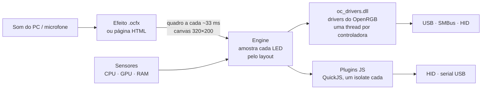

<details>
<summary><b>Organização do projeto</b></summary>

```
lib/src/
  engine/        layout, amostragem dos LEDs, perfis, luz reativa, avisos
  drivers/       ponte com os drivers nativos (oc_drivers.dll)
  plugins/       plugins JavaScript: API, leitura, aprovação e workers
  effects/       biblioteca de efeitos, renderizador .ocfx e host WebView2
  fans/          curvas e controle das ventoinhas
  monitor/       leituras do sistema (lado nativo em windows/runner)
  checkup/       diagnóstico e análise de telas azuis
  alerts/        avisos e notificações
  ai/            assistente: provedores, chaves (DPAPI) e contexto do PC
  ui/            as telas
lib/l10n/        traduções (inglês e português)
windows/runner/  código nativo: monitor, ventoinhas (PawnIO/NvAPI), testes
                 de estresse, áudio, bandeja, elevação e checagens de segurança
windows/drivers/ oc_drivers.dll: drivers do OpenRGB com a API C do OpenChroma
third_party/openrgb/  o código do OpenRGB usado pelos drivers
```

</details>

## 🔒 Privacidade e segurança

- **Sem telemetria, sem conta.** A única conexão automática é a busca
  diária por atualizações na API de releases do GitHub, que dá para
  desligar em Configurações › Sobre.
- O assistente de IA fica desligado até você colocar uma chave. A chave é
  criptografada para o seu usuário do Windows (DPAPI) e só vai para o
  provedor escolhido, junto com as leituras do PC usadas na resposta. HTTP
  simples só vale para servidores no seu próprio PC.
- Plugins que você adiciona só rodam depois de aprovados, e precisam de
  nova aprovação quando mudam com o app rodando como administrador.
- As configurações ficam em `%APPDATA%\OpenChroma`.
- Achou uma vulnerabilidade? Veja o [SECURITY.md](SECURITY.md).

## ⚠️ Aviso

O OpenChroma escreve no **SMBus** (RGB da memória e da placa de vídeo),
**controla a velocidade das ventoinhas** (inclusive a bomba), instala o
**driver de kernel [PawnIO](https://pawnio.eu)** e pode **rodar como
administrador**. Escritas erradas no hardware podem, em casos raros, fazer
um dispositivo se comportar mal, perder as configurações ou estragar de
vez. O OpenRGB tem um aviso parecido. O software é fornecido **"como está",
sem garantia de nenhum tipo**, como diz a [GPL](LICENSE). Ao usar, você
aceita esses riscos.

O OpenChroma é um projeto independente, **sem vínculo, apoio ou patrocínio**
da Razer, Corsair, ASUS, Logitech, Gigabyte, MSI, Kingston, Sony ou de
qualquer outra marca citada. As marcas pertencem aos seus donos e só
aparecem para identificar hardware compatível.

## 🤝 Contribuindo

Relatos de bug, testes de dispositivos, plugins, traduções e código são
todos bem-vindos.

```powershell
flutter pub get
flutter run -d windows   # Flutter 3.47+ e Visual Studio 2022 com C++ para desktop
flutter test
```

- [CONTRIBUTING.md](CONTRIBUTING.md): ambiente, testes, estilo e traduções.
- [docs/PLUGINS.md](docs/PLUGINS.md): plugins de dispositivos em
  JavaScript.
- [docs/BUILDING.md](docs/BUILDING.md): gerar o instalador e as versões.
- [ROADMAP.md](ROADMAP.md) · [CHANGELOG.md](CHANGELOG.md)

## 📄 Licença

O OpenChroma é software livre sob a **GPL-2.0-or-later** ([LICENSE](LICENSE)).
Os drivers vêm do OpenRGB; o código de terceiros incluído e as licenças
estão em [THIRD_PARTY.md](THIRD_PARTY.md). Os módulos PawnIO em
`assets/pawnio` são LGPL-2.1 (veja `assets/pawnio/COPYING.txt`).

<div align="center">
<sub>Feito para quem só quer o PC bonito e fresquinho.</sub>
</div>
