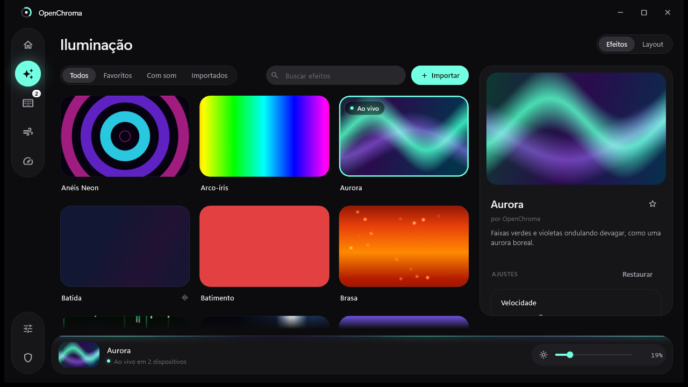
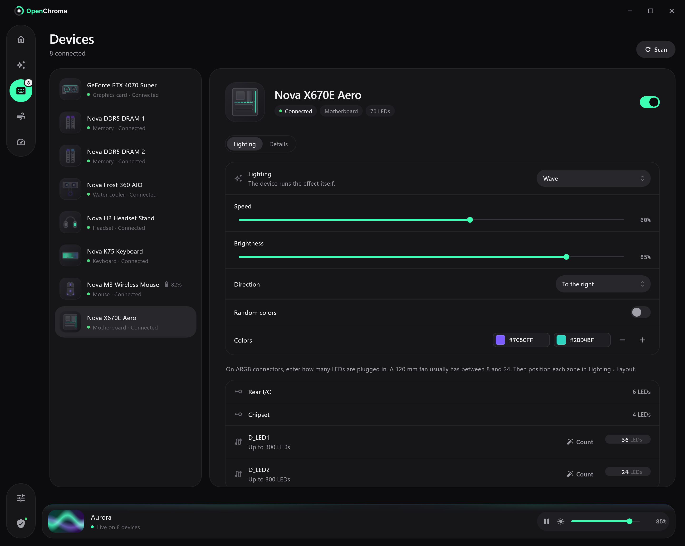

# OpenChroma

[English](README.md) | **Português (Brasil)**

[](https://github.com/Dnowdd/OpenChroma/actions/workflows/ci.yml)
[](LICENSE)
[](https://github.com/Dnowdd/OpenChroma/releases)
[](#instalação)

Controle o PC inteiro de um lugar só: a iluminação RGB de todos os
dispositivos, as ventoinhas, a temperatura e a saúde do sistema. Gratuito,
open source e feito para Windows.

> **Status: beta.** O OpenChroma 0.9 é a primeira versão pública. Ainda tem
> arestas para aparar; por favor,
> [relate os problemas](https://github.com/Dnowdd/OpenChroma/issues/new/choose).
> Leia o [aviso](#aviso--use-por-sua-conta-e-risco) antes de usar.


## O que ele faz

**Iluminação**
- 25 efeitos próprios: Aurora, Plasma, Lava, Fogueira, Chuva Digital, Céu
  Estrelado, Arco-íris, Cor Sólida, Batimento, Sirene e mais. Cada um tem
  ajustes de cor e velocidade.
- Efeitos que reagem ao som do PC ou do microfone (Espectro, Equalizador
  Neon, Batida, Onda Sonora…).
- Layout: posicione cada dispositivo numa tela e o efeito "passa" por eles
  como se fossem um painel só.
- Perfis (Jogo, Trabalho, Noite, Desligado) que trocam efeito e brilho com um
  clique. Clique com o botão direito num perfil para salvar a iluminação atual
  nele.
- Luz reativa: os LEDs mostram a temperatura da CPU ou da GPU, do azul
  (frio) ao vermelho (quente).
- Importe efeitos `.ocfx` (veja abaixo) ou páginas HTML com canvas.

**Ventoinhas**
- Lê e controla as ventoinhas da placa-mãe (chips ITE) e da placa de vídeo
  NVIDIA, com perfis Silencioso, Equilibrado e Turbo ou uma curva sua.
- Marca qual ventoinha é a bomba do water cooler, para ela nunca parar.

**Desempenho**
- Monitor em tempo real: uso e temperatura de CPU e GPU, memória, discos,
  rede e os processos que mais pesam.
- Diagnóstico: testes de estresse de CPU, memória, GPU e disco que conferem
  os resultados (não só esquentam o PC), inventário de hardware, histórico de
  telas azuis e recomendações.

**Avisos**
- Notificação do Windows quando algo esquenta demais, a memória ou o disco
  enchem, ou a bomba do water cooler para. Funciona com o app na bandeja.
- Opcional: os LEDs piscam em vermelho junto com o aviso.

**Assistente de IA**
- Pergunte sobre o seu PC ("por que tá lento?", "o que esquenta a GPU?"): o
  assistente responde com as leituras reais da máquina.
- Peça um efeito ("cria um efeito azul calmo") e aplique com um clique.
- Explica o resultado do diagnóstico e sugere o que fazer.
- Funciona com a sua chave da Anthropic (Claude), da OpenAI (GPT) ou de
  qualquer serviço compatível com a API da OpenAI (OpenRouter, Groq, Ollama,
  LM Studio…). A lista de modelos é buscada no provedor e se atualiza
  sozinha.

**No dia a dia**
- Fecha para a bandeja e continua cuidando das luzes e ventoinhas.
- Pode abrir junto com o Windows, inclusive como administrador sem pedir UAC
  toda vez (só quando instalado para todos os usuários, em Arquivos de
  Programas, para que outros programas não troquem os arquivos que rodam
  como administrador).
- Em inglês por padrão, com tradução para português (Brasil): troque em
  **Configurações › Geral › Idioma**.

| Efeitos | Dispositivos |
|---|---|
|  |  |

## Aviso / use por sua conta e risco

O OpenChroma conversa com o hardware em baixo nível. Em especial, ele:

- escreve no **SMBus** para controlar o RGB das memórias RAM e das placas de
  vídeo;
- **controla a velocidade das ventoinhas**, inclusive a bomba do water
  cooler se você marcar uma;
- instala o **driver de kernel [PawnIO](https://pawnio.eu)** (necessário para
  o SMBus, a temperatura da CPU e as ventoinhas da placa-mãe);
- pode **rodar como administrador**, inclusive ao iniciar o Windows.

Escritas erradas no hardware podem, em casos raros, fazer um dispositivo se
comportar mal, perder as configurações ou até ser danificado de vez
("brickar"). O OpenRGB, de onde vem a maior parte dos drivers do OpenChroma,
tem um aviso parecido. O software é fornecido **"no estado em que se
encontra", sem garantia de nenhum tipo**, como diz a [GPL](LICENSE). Ao usá-lo
você aceita esses riscos.

O OpenChroma é um projeto independente. **Não tem vínculo, aprovação nem
patrocínio** da Razer, Corsair, ASUS, Logitech, Gigabyte, MSI, Kingston, Sony
ou de qualquer outra marca citada aqui. Todas as marcas registradas pertencem
aos seus donos e são usadas só para identificar o hardware compatível.

## Instalação

Baixe a versão mais recente em
[Releases](https://github.com/Dnowdd/OpenChroma/releases):

- **`OpenChroma-x.y.z-setup.exe`**: o instalador. Por padrão instala só para
  o seu usuário, sem pedir administrador; escolha "todos os usuários" para
  instalar em Arquivos de Programas, o que é necessário para abrir como
  administrador no logon. Instala o Microsoft WebView2 se faltar.
- **`OpenChroma-x.y.z-portable.zip`**: extraia numa pasta e abra
  `openchroma.exe`. Não instala nada.
- **`SHA256SUMS.txt`**: os checksums, para conferir o download.

Requisitos:

- Windows 10 (1809 ou mais novo) ou Windows 11, 64 bits.
- [Microsoft WebView2](https://developer.microsoft.com/microsoft-edge/webview2/)
  só para efeitos HTML importados. Já vem no Windows 11; o instalador cuida
  disso no Windows 10.
- O driver [PawnIO](https://pawnio.eu) para o RGB da memória RAM e das placas
  de vídeo, a temperatura da CPU e as ventoinhas da placa-mãe. O instalador
  traz o setup oficial e o instala em segundo plano. Essas funções também precisam
  do modo administrador (tem um botão para isso no app).

O `.exe` ainda não é assinado digitalmente, então na primeira vez o
SmartScreen pode mostrar "O Windows protegeu o computador". Clique em **Mais
informações › Executar assim mesmo**.

Feche outros programas de RGB (iCUE, G HUB, RGB Fusion, OpenRGB…) antes de
usar: dois programas escrevendo nos mesmos LEDs fazem as cores piscarem. O
OpenChroma avisa quando encontra um deles aberto.

## Dispositivos compatíveis

Os drivers do OpenChroma vêm do código aberto do
[OpenRGB](https://gitlab.com/CalcProgrammer1/OpenRGB), compilado dentro do
próprio app: mais de mil teclados, mouses, headsets, mousepads, placas-mãe,
controladoras ARGB, water coolers, memórias RAM e placas de vídeo de dezenas
de marcas (ASUS, Corsair, Logitech, Razer, SteelSeries, HyperX, Gigabyte, MSI,
NZXT, Lian Li, Cooler Master…). Não é preciso instalar o OpenRGB nem nenhum
outro programa.

**Testados pelo autor** em hardware de verdade:

| Dispositivo | Como |
|---|---|
| Teclado Attack Shark K86 (luz tecla por tecla, tela, relógio) | Plugin |
| Mouse Attack Shark X11 (luz, efeitos do mouse, bateria; no cabo e em 2.4 GHz) | Plugin |
| Mouse Logitech G403 HERO | Plugin |
| Controle Sony DualShock 4 (com bateria) | Plugin |
| Water cooler SmartMonitorX28 com tela redonda (serial USB CH9340) | Plugin |
| Memória RAM Kingston Fury DDR5 | Driver embutido (SMBus) |
| RGB da placa-mãe Gigabyte B650M AORUS ELITE AX ICE | Driver embutido |

**Todo o resto não foi testado por este projeto.** Esses dispositivos usam
drivers herdados do OpenRGB que compilam e passam nos testes automáticos, mas
ninguém os experimentou com o OpenChroma ainda. Devem funcionar tão bem
quanto no OpenRGB, mas sem promessas. Se testar um, conte como foi numa
[issue](https://github.com/Dnowdd/OpenChroma/issues/new/choose); para hardware
que não é detectado, use o formulário de pedido de dispositivo.

- Memórias RAM e placas de vídeo com RGB usam o SMBus, que precisa do modo
  administrador e do driver [PawnIO](https://pawnio.eu).
- Conectores ARGB da placa-mãe: informe quantos LEDs estão ligados em cada um
  na tela Dispositivos.
- Cada dispositivo pode seguir os efeitos do OpenChroma ou rodar um efeito do
  próprio hardware.
- Dá para escrever plugins em JavaScript para dispositivos novos ou para
  melhorar os existentes: veja [docs/PLUGINS.md](docs/PLUGINS.md) (em
  inglês). Os plugins incluídos ficam em [`assets/plugins`](assets/plugins).

## Efeitos `.ocfx`

Um efeito é um arquivo JSON com camadas desenhadas de baixo para cima:

```json
{
  "openchroma": 1,
  "name": "Oceano Calmo",
  "description": "Azuis indo e vindo devagar.",
  "background": "#000814",
  "params": {
    "speed": { "label": "Velocidade", "type": "number", "min": 0, "max": 100, "default": 25 },
    "color": { "label": "Cor", "type": "color", "default": "#38BDF8" }
  },
  "layers": [
    { "type": "gradient", "colors": ["#001D3D", "#003566", "#000814"], "angle": 20, "speed": "$speed" },
    { "type": "wave", "color": "$color", "amplitude": 0.2, "thickness": 0.25, "speed": "$speed", "blend": "screen" }
  ]
}
```

Camadas: `solid`, `gradient`, `spectrum`, `pulse`, `wave`, `sweep`, `rings`,
`sparkle`, `plasma`, `noise`, `fire`, `rain`, `stars`, `heartbeat`, `strobe`
e, para áudio, `bars`, `meter`, `ripple` e `flash`. Um valor `"$nome"` usa o
parâmetro `nome`; `"@bass"`, `"@mid"`, `"@treble"`, `"@level"` e `"@beat"`
usam o som em tempo real. Os efeitos que vêm com o app estão em
[`assets/effects`](assets/effects) e servem de exemplo.

## Privacidade

- Não há telemetria. A única conexão automática é a busca diária por
  atualizações na API de releases do GitHub (desligue em Configurações ›
  Sobre); ela não envia nada sobre o seu PC.
- A chave de API do assistente fica só neste PC, criptografada para o seu
  usuário do Windows (DPAPI), e só vai para o provedor que você escolheu,
  junto com as leituras do PC usadas para responder (modelo do hardware,
  temperaturas, uso, nomes dos dispositivos e dos processos que mais pesam).
- HTTP simples só é aceito para servidores de IA rodando neste PC.
- Configurações ficam em `%APPDATA%\OpenChroma`.

## Para desenvolvedores

Precisa do [Flutter](https://docs.flutter.dev/get-started/install/windows)
3.47 ou mais novo e do Visual Studio 2022 (ou mais novo) com a carga
"Desenvolvimento para desktop com C++".

```powershell
flutter pub get
flutter run -d windows        # rodar em modo debug
flutter test                  # testes
```

A documentação para desenvolvedores está em inglês:

- [CONTRIBUTING.md](CONTRIBUTING.md): ambiente, testes, estilo de código,
  traduções e como mandar um pull request.
- [docs/BUILDING.md](docs/BUILDING.md): gerar o `.exe` e o instalador e
  publicar uma versão.
- [docs/PLUGINS.md](docs/PLUGINS.md): escrever plugins de dispositivos.
- [ROADMAP.md](ROADMAP.md): o que ainda falta.
- [CHANGELOG.md](CHANGELOG.md): o que mudou em cada versão.
- [SECURITY.md](SECURITY.md): como relatar uma vulnerabilidade.

### Como funciona

```
lib/src/
  engine/        motor: layout, amostra o efeito em cada LED e manda para os
                 drivers; perfis, luz reativa e o piscar dos avisos
  drivers/       ponte com os drivers nativos (oc_drivers.dll)
  plugins/       plugins JavaScript: API, leitura e o worker de cada
                 dispositivo (QuickJS)
  hid/           acesso USB HID direto pelo Windows, para os plugins
  effects/       biblioteca de efeitos, o renderizador .ocfx em Dart e o
                 WebView2 dos efeitos HTML importados
  fans/          curvas e controle das ventoinhas
  monitor/       leituras do sistema (lado nativo em windows/runner)
  checkup/       diagnóstico e análise de telas azuis
  alerts/        avisos e notificações
  ai/            assistente: provedores, chaves (DPAPI) e contexto do PC
  ui/            as telas
lib/l10n/        traduções (inglês e português)
windows/runner/  código nativo: monitor, ventoinhas (PawnIO/NvAPI), testes
                 de estresse, captura de áudio, bandeja e elevação
windows/drivers/ oc_drivers.dll: os drivers do OpenRGB com a API C do
                 OpenChroma (oc_drivers.cpp)
third_party/openrgb/  cópia do código do OpenRGB usada pelos drivers
```

A cada ~33 ms o efeito desenha um quadro do canvas de 320x200: os `.ocfx`
direto em Dart, os HTML importados numa página do WebView2, que só abre
quando um deles está ativo. O app calcula a cor de cada LED pela posição do
dispositivo no layout e entrega para o driver, que escreve no hardware na
sua própria thread.

## Licença

O OpenChroma é software livre sob a GPL-2.0-or-later ([LICENSE](LICENSE)).
Os drivers vêm do OpenRGB; o código de terceiros incluído e suas licenças
estão em [THIRD_PARTY.md](THIRD_PARTY.md).

Os módulos PawnIO em `assets/pawnio` são distribuídos sob a LGPL 2.1 (veja
`assets/pawnio/COPYING.txt`).
